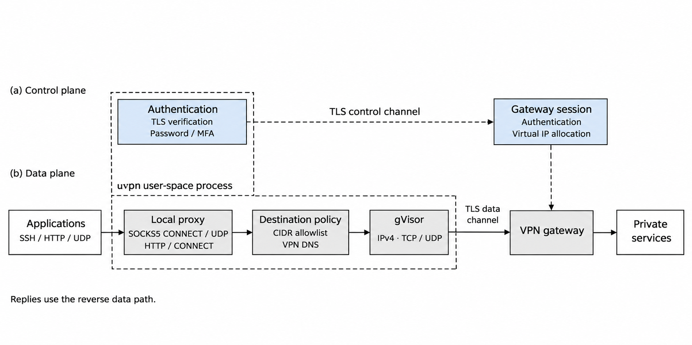
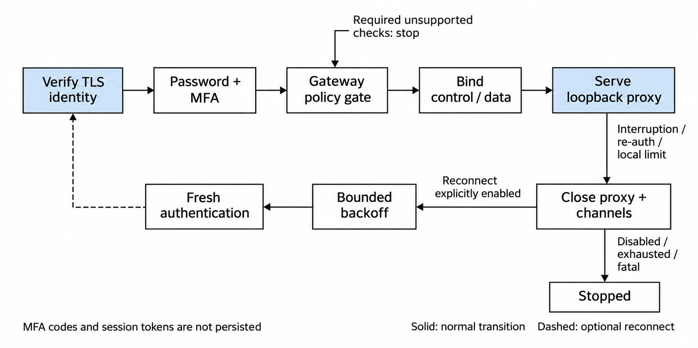

# UniVPN CLI

[](https://github.com/howtomakeaname/univpn-cli/actions/workflows/ci.yml)
[](https://github.com/howtomakeaname/univpn-cli/releases)
[](LICENSE)

A Go CLI for UniVPN SSL VPN, with local **SOCKS5 and HTTP proxies**.

[简体中文](README.zh-CN.md) · [Releases](https://github.com/howtomakeaname/univpn-cli/releases) · [Configuration](config.example.json) · [Validation](docs/validation.md)

## Features

- Password authentication with interactive SMS/email MFA.
- A mixed SOCKS5 / HTTP / HTTPS CONNECT listener, including SOCKS5 UDP ASSOCIATE.
- Rootless IPv4 networking with the gVisor TCP/IP stack. No system TUN device or route changes.
- Verified TLS on both VPN channels, private CA support, and explicit certificate pinning.
- Explicit destination CIDRs, VPN-side name resolution, bounded queues and independent keepalives.
- A single executable: `uvpn`, including an SSH `ProxyCommand` helper.
- Explicit, bounded reconnect with fresh authentication; gateway revocation and unsupported security policies close the tunnel.

**Experimental:** compatibility is currently limited to the tested UniVPN v1 IPv4-over-TLS profile. See [scope](docs/protocol.md) and [validation](docs/validation.md). This is an independent project, not an official vendor client.



SOCKS5 TCP and UDP share the same destination policy and user-space network stack. Both travel inside the TLS data channel; HTTP proxy traffic uses TCP.

## Install

Download an archive from [Releases](https://github.com/howtomakeaname/univpn-cli/releases), verify it against `SHA256SUMS`, and extract it.

| Platform | Architectures | Executable |
| --- | --- | --- |
| Linux | amd64, arm64 | `uvpn` |
| macOS | amd64, arm64 | `uvpn` |
| Windows | amd64, arm64 | `uvpn.exe` |

macOS and Windows packages are unsigned. Cross-platform builds and native CI tests are separate from live gateway validation.

## Quick start

Copy [config.example.json](config.example.json) to `uvpn.local.json`. Set your gateway, VPN username and permitted internal addresses:

```json
{
  "gateway": "vpn.example.com:443",
  "username": "YOUR_VPN_USERNAME",
  "listen": "127.0.0.1:7890",
  "allow_cidrs": ["10.20.30.40/32"],
  "hosts": {"atlas.internal": "10.20.30.40"}
}
```

```sh
uvpn connect -config uvpn.local.json
```

Enter your VPN password and, when requested, the SMS/email code. `READY` means the proxy is available. Keep the process running; press Ctrl-C to disconnect.

TLS certificate and hostname verification are enabled by default. For a private CA, set `ca_file`; for an IP gateway with a certificate issued to a verified hostname, set `server_name`. Alternatively, set `cert_sha256` to a trusted SHA-256 fingerprint of the DER leaf certificate. Obtain trust information from your gateway administrator. `inspect-cert` only reports an **unverified** observation and does not change trust.

```sh
uvpn inspect-cert -config uvpn.local.json
uvpn probe -config uvpn.local.json
```

`probe` checks TLS and protocol setup without submitting credentials. Relative file paths resolve from the configuration directory.

By default, `uvpn` derives a deterministic locally-administered unicast MAC address from the username and gateway. For gateways that enforce a registered client MAC address, set the optional `mac` field in the JSON config (6-octet unicast formats such as `02:11:22:33:44:55`, `02-11-22-33-44-55`, `0211-2233-4455`, or `0211.2233.4455`).

## Use the proxy

```sh
ssh -o 'ProxyCommand=uvpn dial %h:%p' SSH_USER@10.20.30.40
curl --proxy socks5h://127.0.0.1:7890 http://atlas.internal:8080/
curl --proxy http://127.0.0.1:7890 https://atlas.internal/
```

Put `uvpn` on PATH or use its absolute path in `ProxyCommand`. SSH credentials and host-key verification remain with OpenSSH. Destination TLS verification remains with the application.

Names resolve through `hosts` or an explicitly configured VPN DNS server. Targets outside `allow_cidrs` are rejected; there is no direct-connection fallback. The listener accepts numeric loopback addresses only, but other local processes can use it.

Passwords and session tokens are not logged or exported. Unix users may set `password_file` to a private file with mode `0600`; Windows users should use the interactive prompt or `--password-stdin`. `--otp-stdin` reads a code only when requested by the gateway. See the [Chinese usage guide](README.zh-CN.md) for automation and spreadsheet import.

UDP applications must support SOCKS5 UDP ASSOCIATE; an HTTP proxy cannot forward UDP. Keep its SOCKS TCP control connection open. Each association permits 32 destination flows, binds its client source, and expires idle resources. SOCKS fragmentation is unsupported; ordinary IPv4 fragmentation is handled inside the VPN stack.

For mihomo / Clash composition, set `listen` to an unused loopback endpoint such as `127.0.0.1:10808` and use it as a SOCKS5 upstream. See the [interface and routing reference](docs/proxy-chaining.md) for domain/IP selection, DNS and routing-loop considerations. This project does not install or configure a routing client.

SOCKS5 and CONNECT relay application bytes without terminating destination TLS. Ordinary HTTP preserves the client's User-Agent, encoding negotiation and encoded response body, but parses and serializes HTTP. Gateway TLS, virtual TCP/IP and timing can differ from the vendor client; no identical-fingerprint or identification guarantee is made. See [traffic compatibility](docs/traffic-compatibility.md).

## Sessions and MFA



By default, a session interruption closes the proxy and exits. To permit up to three fresh login attempts after a network interruption, re-authentication request or local session limit:

```sh
uvpn connect -config uvpn.local.json -reconnect-attempts 3
```

The old listener, UDP associations, network stack and both channels close before a retry. Backoff is bounded; a rejected login, revoked session, invalid certificate or unsupported endpoint policy stops retries. Existing application connections are not resumed.

`session_max_seconds` optionally caps local session use (`0` disables the cap; otherwise `60..604800`). It does not extend the gateway's validity period. Keepalives detect connectivity; they are not token renewal.

**MFA is not persisted.** One-time codes are cleared after use, and session tokens stay in process memory and are cleared on shutdown. Every new login follows the gateway's authentication requirements. There is no implemented remember-device or cross-process token-resumption option; storing an SMS code would not provide either.

## Scope

Supported: SOCKS5 CONNECT and UDP ASSOCIATE, ordinary HTTP and HTTP CONNECT over IPv4/TLS; explicit fresh-login reconnect; endpoint-policy detection and refusal when required checks cannot be completed.

Not implemented: outer encrypted UDP/DTLS tunnels, legacy HTTP-authenticated VPN sessions, IPv6, IPsec, browser SSO, client-certificate login, endpoint compliance plugins, password changes, transparent connection migration or persistent MFA trust. A gateway requiring unsupported checks needs its official security components; the CLI never reports those checks as passed. Ordinary HTTP proxy requests use separate connections; use CONNECT for streaming upgrades. TCP-over-TCP performance depends on network conditions.

## Build and test

Use the Go version in [.go-version](.go-version):

```sh
make build
make test
make check
```

CI runs tests on Linux, macOS and Windows. Tagged releases build six platform archives and publish checksums. Contributions should include tests for protocol, proxy or security behavior changes; never submit credentials, private configurations or packet captures.

## License and acknowledgements

[MIT](LICENSE). Dependencies keep their respective licenses; see [third-party notices](THIRD_PARTY_NOTICES.md). Thanks to [gVisor](https://github.com/google/gvisor) for the user-space network stack and the independent [UniVPN Connect](https://github.com/Bruce-lhq/univpn-connect) project for public interoperability notes. UniVPN and other product names remain the trademarks of their respective owners.
