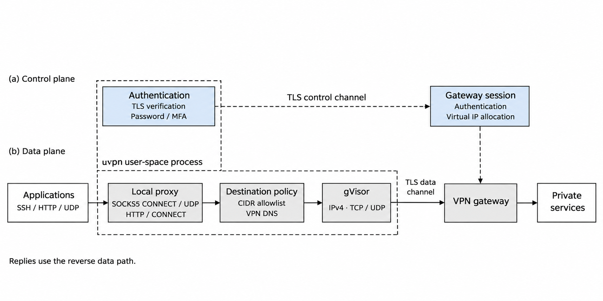
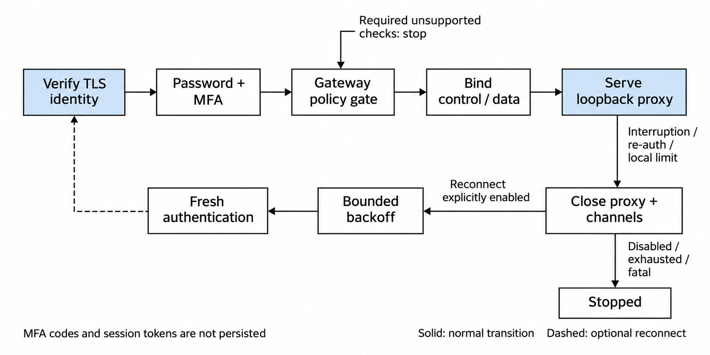

# UniVPN CLI

`uvpn` 是独立的 UniVPN SSL VPN 命令行客户端，将 VPN 内网暴露为本机 SOCKS5 / HTTP 代理。用 Go 和 gVisor TCP/IP 栈实现，不需要 root、系统 TUN 网卡或修改主机路由。

当前为实验版本，支持已验证网关的 **UniVPN v1、密码＋短信/邮箱验证码、IPv4 over TLS**。本项目与 UniVPN 的厂商没有隶属关系；品牌及商标归各自权利人所有。



SOCKS5 的 TCP/UDP 共用目标白名单与 VPN DNS，均经 TLS 数据通道传输；HTTP/CONNECT 仅转发 TCP。

## 安装与连接

从 [Releases](https://github.com/howtomakeaname/univpn-cli/releases) 下载对应平台的包，核对 `SHA256SUMS` 后解压。Linux/macOS 可执行 `./uvpn`，Windows 使用 `uvpn.exe`。

从源码构建：

```sh
make build
cp config.example.json uvpn.local.json
./bin/uvpn connect -config uvpn.local.json
```

编辑配置中的 VPN 网关、VPN 用户名、允许访问的内网 IP，并交互输入 VPN 密码和网关要求的验证码。VPN 与 SSH 使用各自的账号。看到 `READY` 后，代理地址默认为 `127.0.0.1:7890`。

证书默认使用系统信任库，并校验主机名/IP。私有 CA 可在配置中加入 `"ca_file": "trusted-ca.pem"`。连接 IP 而证书签给域名时，使用经过核实的 `"server_name": "vpn.example.com"`。

对于自签名证书，可以显式设置可信的完整叶证书 SHA-256：

```json
"cert_sha256": "64位十六进制叶证书DER摘要"
```

该固定指纹代替 CA/主机名信任，两个 TLS 通道都校验指纹及证书有效期。应从环境提供方获取指纹；`inspect-cert` 只显示未经核验的观察结果，首次信任（TOFU）需由使用者明确决定，没有自动信任或跳过登录证书校验的选项。

```sh
uvpn inspect-cert -config uvpn.local.json
uvpn probe -config uvpn.local.json
```

`probe` 只验证 TLS 与协议握手，不发送凭据。相对文件路径以配置文件目录为基准。

## SSH 与 HTTP

自带的 `dial` 命令可用于 OpenSSH，省去外部 `nc` 版本差异：

```sh
ssh -o 'ProxyCommand=uvpn dial %h:%p' SSH_USER@10.20.30.40
curl --proxy socks5h://127.0.0.1:7890 http://atlas.internal:8080/
curl --proxy http://127.0.0.1:7890 https://atlas.internal/
```

`uvpn` 需在 PATH 中，也可在 `ProxyCommand` 写绝对路径。SSH 主机密钥校验继续由 OpenSSH 负责。HTTP 与 HTTPS 的目标证书、认证继续由应用负责。

`allow_cidrs` 必填，建议只开放分配的 `/32` 主机地址；它限制最终目标 IP，域名解析结果也逐个检查。域名通过静态 `hosts` 或显式指定的内网 DNS 解析；没有配置时不会使用本机 DNS 解析代理目标，也不会回退到直连。`dns` 指定的解析流量同样经过 VPN，目前使用列表中的第一个服务器。内网别名仅在代理中有效。

UDP 应用需要支持 SOCKS5 UDP ASSOCIATE，并在使用期间保持其 SOCKS TCP 控制连接。每个关联绑定客户端来源，最多 32 个目的流；目的流空闲 60 秒回收，关联 5 分钟无客户端数据回收。支持完整的 SOCKS UDP 报文，不支持 SOCKS 分片；底层 IPv4 分片由网络栈重组。这是 **UDP over TLS**，不表示外层 DTLS 已实现。

## 会话、重连与 MFA



默认在通道故障后关闭代理并退出。可显式允许有限次数的完整重新登录：

```sh
uvpn connect -config uvpn.local.json -reconnect-attempts 3
```

参数范围 `0..10`，默认 `0`。网络中断、网关要求重新认证或本地时长上限触发后，先关闭旧代理、UDP 关联、双通道与网络栈，再以有上限的退避重新登录。每次重新验证 TLS、读取密码，并按网关要求索取新验证码；已打开的 SSH/HTTP/UDP 连接不会自动迁移。登录被拒、网关踢出、错误证书或合规要求不支持时停止，不反复尝试。

配置项 `session_max_seconds` 是本地使用时长上限：`0` 表示关闭，其他取值为 `60..604800` 秒。它不是网关令牌有效期，不会延长服务端会话。心跳用于保活与连通性检测，不等于令牌续期。

**目前不持久化 MFA 状态。** 验证码仅用于当次认证，使用后清除；会话 token 仅在进程内存，关闭时清理。配置、可信证书指纹和密码文件路径可以持久保存，但没有“记住设备”或跨进程恢复会话的选项。保存短信验证码不能让它长期有效；重新启动客户端仍遵循网关的认证要求。

若网关要求端点合规检查，CLI 会报告检查标识与模式并拒绝开启数据通道，需使用配套的官方安全组件；不会伪造检查通过结果。

## 凭据与无人值守

Unix 可以配置一个权限为 `0600` 的 `password_file`，文件中只有 VPN 密码；只去掉末尾一个换行，不会裁剪密码内的空格。Windows 使用交互密码输入，或从受保护的调用方通过 `--password-stdin` 传入，不使用 Unix 文件权限作为 Windows ACL 的替代。

```sh
uvpn connect -config uvpn.local.json --password-stdin --otp-stdin
```

两项分别从 stdin 读取一行；验证码只在网关提出要求时读取。不要把密码写进命令参数、Git、共享配置或终端历史。普通运行日志不记录密码、验证码、令牌或数据包；敏感内存缓冲区会尽力清零，Go 运行时不提供完整的秘密内存保证。回环端口上的其他本机进程仍可使用代理。

HiDevLab 表格可在本机导入：

```sh
python3 tools/import_environment.py /path/to/environment.xlsx
uvpn connect -config .private/hidevlab.json
```

导入器只保存 VPN 密码与访问目标，不复制 SSH/BMC 密码，拒绝覆盖已有文件。`.private`、本地配置、日志和安装包均不入库。

## 验证与范围

```sh
make test
make check
```

测试覆盖 TLS CA/指纹与主机名拒绝、MFA、分片帧、连接取消、丢包后的 TCP 重传、并发 TCP/UDP 双通道转发、UDP 来源隔离与资源回收、HTTP 请求体、CONNECT 预读数据、目标白名单、合规拒绝和独立 MFA 的重连流程。支持 Linux/macOS/Windows 的 amd64/arm64 构建；各平台原生运行的覆盖以 Actions 结果为准，交叉编译不等于在每种硬件上实测。

当前支持 SOCKS5 CONNECT/UDP ASSOCIATE、普通 HTTP 和 HTTP CONNECT；HTTP 普通请求使用独立连接，流式升级可走 CONNECT。暂不支持外层加密 UDP/DTLS 隧道、旧版 HTTP 认证 VPN 会话、IPv6、IPsec、端点合规插件、证书用户认证、浏览器 SSO、自动改密、连接透明迁移或持久 MFA 信任。TLS 隧道内承载 TCP 会有 TCP over TCP 的固有限制。

实网性能与设备检查见 [验证记录](docs/validation.md)，协议说明见 [协议说明](docs/protocol.md)。CI 在 Linux/macOS/Windows 运行测试，推送 `v*` 标签后构建六种发布包并创建预发布 Release。

## 许可

本项目代码采用 [MIT](LICENSE)；依赖保留各自许可证，见 [第三方声明](THIRD_PARTY_NOTICES.md)。发布包不包含厂商二进制、原始附件、网关地址或凭据。
